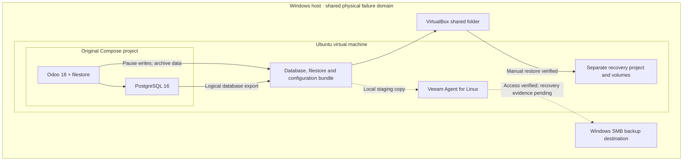
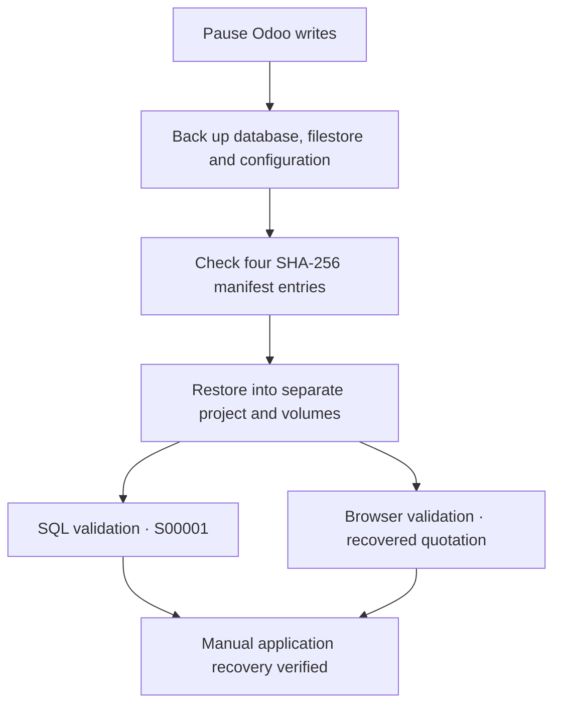

# Odoo Backup & Recovery Lab

**Deploy a business application, back it up, and validate an isolated recovery.**

**Germain Daakpo Amouzou** · Bilingual IT and cybersecurity professional

A hands-on lab using Ubuntu 22.04, Docker Compose, Odoo 18, PostgreSQL 16 and Veeam Agent for Linux. The manual recovery exercise restores quotation **S00001** into a separate application instance. Veeam recovery remains pending supporting evidence.

[View the presentation PDF](docs/Presentation.pdf.pdf) · [PowerPoint release](https://github.com/Daakpo/Odoo-Backup-Recovery-Lab/releases/tag/Backup_Lab) · [Browse uploaded screenshots](ScreenShots_Proofs)

## Results and verification boundaries

| Area | Documented result | Status |
|---|---|---|
| Deployment | Odoo running and PostgreSQL healthy in Docker | Verified in lab |
| Manual backup | Approximately 7.5 MB recovery bundle; four SHA-256 checks pass | Verified in lab |
| Manual recovery | Separate Compose project; restored quotation S00001 appears in SQL and Odoo | Verified in lab |
| SMB destination | Dedicated Windows account successfully writes to the share | Access verified |
| Veeam recovery | Successful final session and restored-file hashes still needed | Pending evidence |
| Bare-metal recovery | Recovery media creation encountered insufficient space | Incomplete |
| Recovery objectives | RTO and RPO have not been formally measured | Not claimed |

These results describe the documented lab. The repository currently provides the presentation and uploaded screenshots; live backup archives and deployment scripts are not included.

## Architecture

Solid arrows show the documented manual backup and recovery path. Dashed arrows represent Veeam staging and integration, without claiming successful Veeam recovery.

The source VM and both backup destinations share the Windows host. Separate recovery volumes provide logical isolation; this setup does not establish protection from loss of the physical host.

## Manual recovery workflow

Checksums establish byte integrity against the manifest. SQL and browser checks establish usable application data. They do not measure recovery time or demonstrate a completed Veeam restore.

## Skills demonstrated

- **Linux operations:** Storage diagnosis, permissions and kernel-module troubleshooting.
- **Containers:** Docker Compose, named volumes, service health and recovery isolation.
- **Database recovery:** PostgreSQL logical backup and restore with SQL validation.
- **Application recovery:** Coordinated Odoo database and filestore recovery.
- **Backup integration:** Veeam Agent for Linux and a dedicated Windows SMB account.
- **Evidence:** SHA-256 verification and documentation of successful and failed attempts.

## Evidence and repository contents

| Location | Available material |
|---|---|
| [Presentation PDF](docs/Presentation.pdf.pdf) | Portfolio project walkthrough |
| [Release](https://github.com/Daakpo/Odoo-Backup-Recovery-Lab/releases/tag/Backup_Lab) | Downloadable PowerPoint presentation |
| [Uploaded screenshots](ScreenShots_Proofs) | 38 images from the lab workflow |
| This README | Project summary, architecture and recovery workflow diagrams |

The earlier release description lists a broader package. Configuration templates, automation scripts and a standalone report are not currently included on `main`. Use the table above as the inventory of available repository materials.

## Next verification milestones

1. Capture a completed Veeam backup session and a valid restore point.
2. Recover files to a separate location and compare their hashes.
3. Measure recovery time and the age of the recovered data.
4. Test a backup copy stored independently of the source Windows host.

## Résumé en français

Déploiement d’Odoo et PostgreSQL dans Docker sur Ubuntu, sauvegarde coordonnée de la base de données et du filestore, puis restauration dans un environnement distinct. Validation par SQL, interface Odoo et empreintes SHA-256. Intégration d’un partage SMB pour Veeam et documentation des limites de récupération.

## Author

**Germain Daakpo Amouzou** · Bilingual IT and cybersecurity professional

[LinkedIn](https://www.linkedin.com/in/gdamouzou) · [GitHub](https://github.com/Daakpo)
