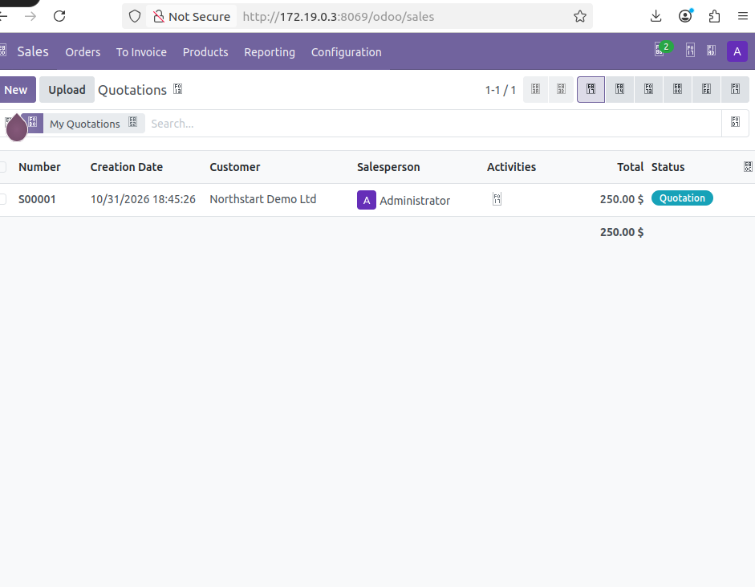
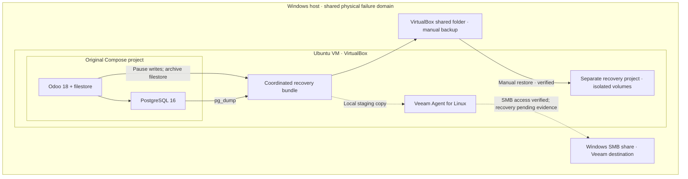
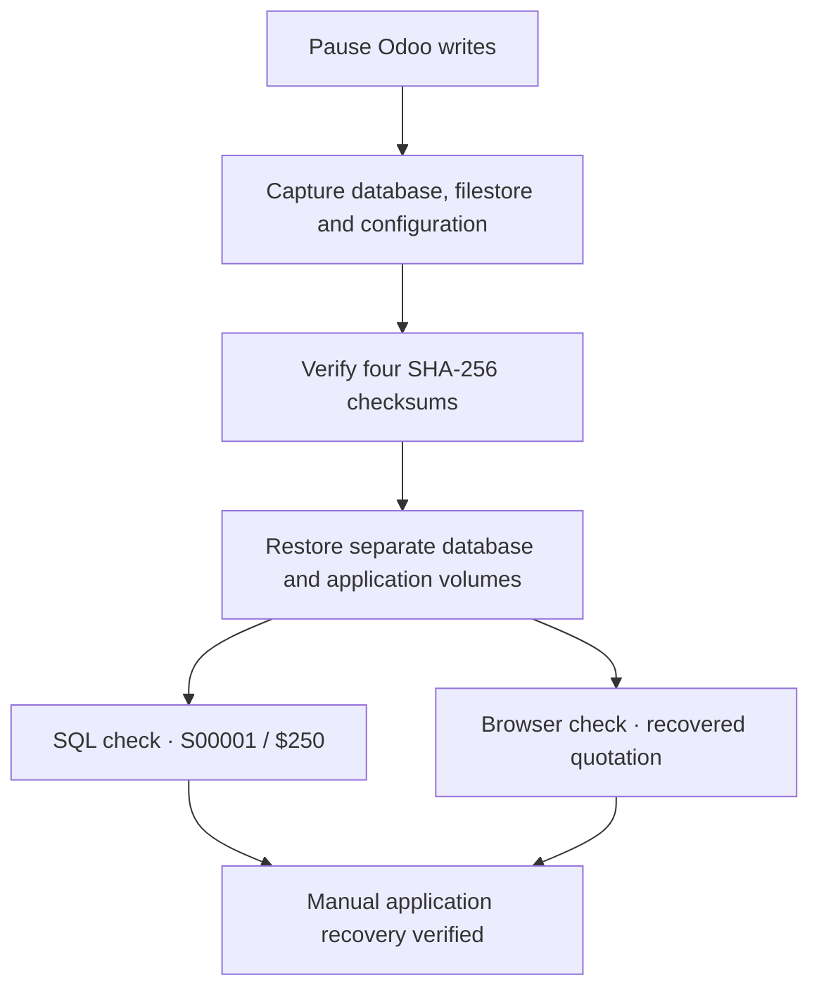

# Odoo Backup & Recovery Lab

**A containerized business application, a verified recovery bundle, and an isolated restore on Ubuntu.**

Germain Daakpo Amouzou · IT infrastructure and cybersecurity portfolio

I built this lab to practise backing up and recovering a business application. I deployed Odoo 18 with PostgreSQL 16 in Docker, created test records and attachments, and restored them into a separate Compose project. I also configured a Windows SMB destination for Veeam Agent for Linux and worked through storage issues on my Ubuntu VM.

I recovered quotation **S00001** in an isolated Odoo instance and verified the database, filestore and configuration bundle with SHA-256 checks. My full-machine Veeam attempt ran into storage problems, so I prepared a smaller recovery bundle for file-level backup.

## Project results

| Component | Result | Evidence |
|---|---|---|
| Odoo and PostgreSQL deployment | Verified running, database healthy | [Deployment](docs/DEPLOYMENT.md) |
| Business record baseline | S00001, Northstart Demo Ltd, $250, attachments | [Application validation](docs/DEPLOYMENT.md#business-record-baseline) |
| Coordinated manual backup | Database, filestore and required configuration, four hashes pass | [Backup and restore](docs/RECOVERY.md) |
| Isolated manual restore | Separate project and volumes, SQL and browser validation | [Recovery evidence](docs/RECOVERY.md#restore-validation) |
| Windows SMB repository | Dedicated account, share access and upload verified | [Veeam integration](docs/VEEAM.md#windows-smb-destination) |
| Veeam full-machine attempt | Stopped after snapshot storage pressure, final state Failed | [Incident review](docs/TROUBLESHOOTING.md) |
| Veeam file backup and file recovery | Follow-up steps completed; final backup and restore screenshots still to be added | [Verification boundary](docs/VEEAM.md#verification-boundary) |



*Restored Odoo serves the quotation list at the recovery container address. See the evidence index for the exact capture and supporting SQL checks.*

## Architecture



[Architecture details](docs/ARCHITECTURE.md)

Solid arrows show the documented manual backup and restore path. Dashed arrows show Veeam staging and integration; they do not claim a successful Veeam recovery.

The manual bundle resides on a VirtualBox shared folder. Veeam uses a separate SMB share. Both destinations are on the Windows host, so this lab does not establish an offsite or independent physical backup copy.

## Recovery workflow



Checksums establish file integrity. SQL and browser checks establish usable application data. These checks do not measure RTO/RPO or prove Veeam recovery.

## Read the project

- [Deployment and application baseline](docs/DEPLOYMENT.md)
- [Manual backup and isolated restore](docs/RECOVERY.md)
- [Veeam Agent and SMB integration](docs/VEEAM.md)
- [Troubleshooting and lessons learned](docs/TROUBLESHOOTING.md)
- [Technical report and engineering notes](docs/REPORT.md) · [Word report](docs/Odoo_Backup_Recovery_Lab_Report.docx)
- [Complete screenshot index](docs/EVIDENCE.md)
- [Presentation PDF](docs/Presentation.pdf) and [PowerPoint presentation](docs/Odoo_Backup_Recovery_Lab.pptx)
- [Presentation outline and talking points](presentation/PRESENTATION.md)

I organized my 118 screenshots into six galleries. I kept the failed attempts because they explain the problems I encountered and how I investigated them.

## Environment

| Layer | Lab configuration |
|---|---|
| Host | Windows 11 Home, Oracle VirtualBox |
| Guest | Ubuntu 22.04 LTS, amd64, approximately 4 GB RAM |
| Guest disk | Approximately 24 GB root filesystem |
| Application | `odoo:18.0` |
| Database | `postgres:16-alpine` |
| Backup software | Veeam Agent for Linux 13.1.2.11 |
| Original access | Ubuntu loopback, `127.0.0.1:8069` |
| Recovery access observed | Recovery container IP, `172.19.0.3:8069` |

The observed container address is session-specific. Reinspect it after recreating the recovery project.

## Reusable configuration

I included sanitized versions of my deployment in [`compose.yaml`](compose.yaml) and [`compose.recovery.yaml`](compose.recovery.yaml). The recovery project uses an internal network, separate volumes and disabled Odoo scheduled workers. My live credentials and private configuration are excluded.

For a new lab deployment on Ubuntu with Docker Engine and the Compose plugin installed:

```bash
cp .env.example .env
chmod 600 .env
# Edit .env and set a unique PostgreSQL password before continuing.
sudo docker compose config -q
sudo docker compose up -d
sudo docker compose ps
```

Open `http://127.0.0.1:8069` inside Ubuntu and create the lab database. Set a unique Odoo database-manager master password and application administrator password. The reconstructed Compose file does not establish persistent management-password hardening by itself.

To verify a private recovery bundle without publishing its contents:

```bash
bash scripts/verify-bundle.sh /path/to/odoo-backup-directory
```

Actual database dumps, filestore archives, `.env` values and private Odoo configuration are excluded from this repository. Recovery archives can contain credentials and must stay in access-controlled storage.

## Repository guide

| Path | Contents |
|---|---|
| `compose.yaml`, `compose.recovery.yaml` | Sanitized deployment and recovery references |
| `.env.example` | Empty password template |
| `scripts/verify-bundle.sh` | Read-only integrity and archive checks |
| `docs/` | Report, runbooks, diagrams and presentation PDF |
| `docs/screenshots/` | 118 publication screenshots, grouped in six galleries |
| `ScreenShots_Proofs/` | Earlier screenshot upload, preserved for history |

## Skills demonstrated

Linux storage diagnosis, Docker Compose administration, PostgreSQL logical backup and restore, Odoo filestore recovery, SHA-256 integrity verification, Windows SMB permissions, scoped firewall configuration, Veeam Agent installation and evidence-based incident documentation.

## Scope and limitations

I completed and validated the manual Odoo recovery. I have not tested production high availability or completed a bare-metal recovery, and I have not measured RTO or RPO. My checksum checks confirm file integrity; the SQL and browser checks confirm that the restored application can serve the recovered data. I still need to add the final Veeam backup and restored-file evidence.

## Résumé en français

J’ai déployé Odoo 18 et PostgreSQL dans Docker sur Ubuntu, sauvegardé la base de données et le filestore, puis restauré l’application dans un environnement distinct. J’ai validé la récupération avec la commande S00001, l’interface Odoo et les empreintes SHA-256. J’ai aussi configuré un partage SMB Windows pour Veeam Agent et documenté les problèmes de stockage rencontrés.

## Author

**Germain Daakpo Amouzou** · Bilingual IT and cybersecurity professional

[GitHub](https://github.com/Daakpo) · [LinkedIn](https://www.linkedin.com/in/gdamouzou)
