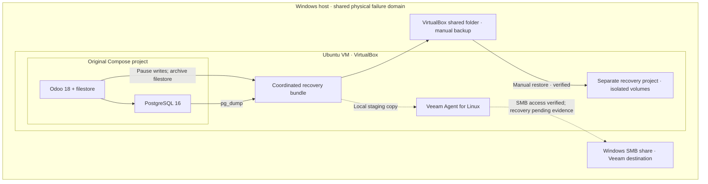
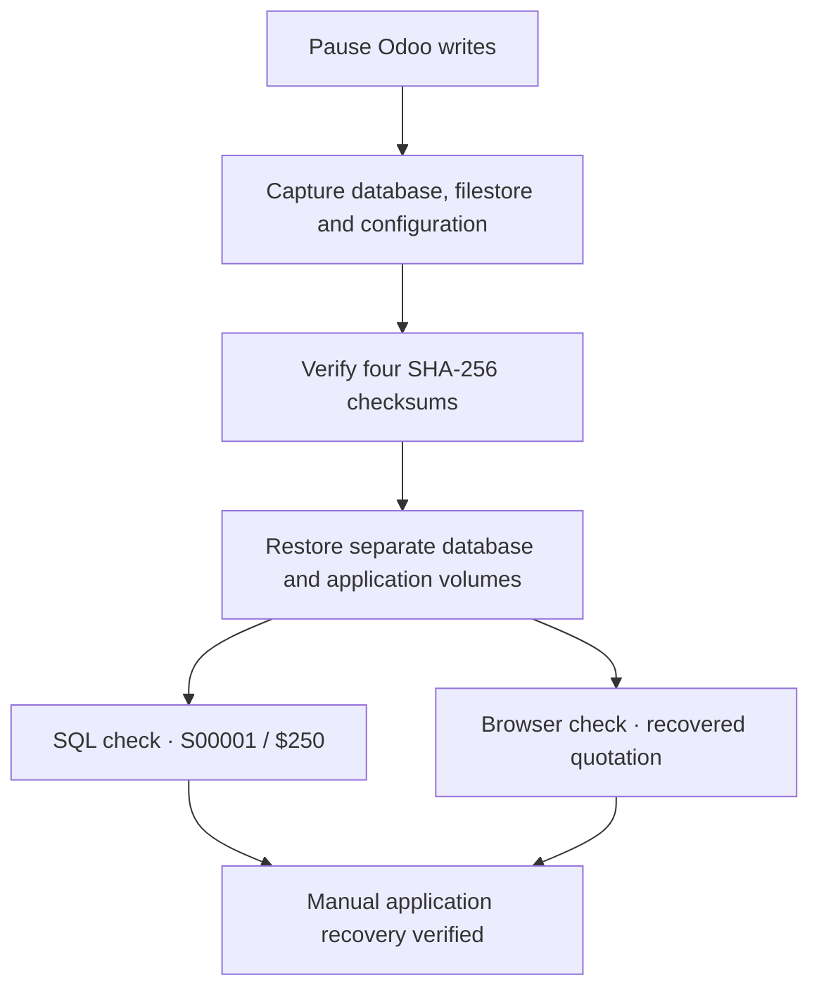

# Odoo Backup & Recovery Lab

**A containerized business application, a verified recovery bundle, and an isolated restore on Ubuntu.**

Germain Daakpo Amouzou · IT infrastructure and cybersecurity portfolio

This lab deploys Odoo 18 with PostgreSQL 16 in Docker, creates business records and attachments, and restores the application into a separate Compose project. It also configures a dedicated Windows SMB destination for Veeam Agent for Linux and documents the troubleshooting required on a storage-constrained VM.

The central recovery result is a working isolated Odoo instance with quotation **S00001**, together with integrity checks on the database, filestore and configuration backup. The Veeam section records the observed job failure and the subsequent preparation of a small recovery bundle for a snapshot-less file backup.

## Project results

| Component | Result | Evidence |
|---|---|---|
| Odoo and PostgreSQL deployment | Verified running, database healthy | [Deployment](docs/DEPLOYMENT.md) |
| Business record baseline | S00001, Northstart Demo Ltd, $250, attachments | [Application validation](docs/DEPLOYMENT.md#business-record-baseline) |
| Coordinated manual backup | Database, filestore and required configuration, four hashes pass | [Backup and restore](docs/RECOVERY.md) |
| Isolated manual restore | Separate project and volumes, SQL and browser validation | [Recovery evidence](docs/RECOVERY.md#restore-validation) |
| Windows SMB repository | Dedicated account, share access and upload verified | [Veeam integration](docs/VEEAM.md#windows-smb-destination) |
| Veeam full-machine attempt | Stopped after snapshot storage pressure, final state Failed | [Incident review](docs/TROUBLESHOOTING.md) |
| Veeam file backup and file recovery | Follow-up steps reported done by the user; success evidence not yet supplied | [Verification boundary](docs/VEEAM.md#verification-boundary) |


*Restored Odoo serves the quotation list at the recovery container address. See the evidence index for the exact capture and supporting SQL checks.*

## Architecture



[Architecture details](docs/ARCHITECTURE.md)

Solid arrows show the documented manual backup and restore path. Dashed arrows show Veeam staging and integration; they do not claim a successful Veeam recovery.

The manual bundle resides on a VirtualBox shared folder. Veeam uses a separate SMB share. Both destinations are on the Windows host, so this lab does not establish an offsite or independent physical backup copy.

## Recovery workflow



Checksums establish file integrity. SQL and browser checks establish usable application data. These checks do not measure RTO/RPO or prove Veeam recovery.

## Read the project

- [Deployment and application baseline](docs/DEPLOYMENT.md)
- [Manual backup and isolated restore](docs/RECOVERY.md)
- [Veeam Agent and SMB integration](docs/VEEAM.md)
- [Troubleshooting and lessons learned](docs/TROUBLESHOOTING.md)
- [Technical report and engineering notes](docs/REPORT.md) · [Word report](docs/Odoo_Backup_Recovery_Lab_Report.docx)
- [Complete screenshot index](docs/EVIDENCE.md)
- [Presentation PDF](docs/Presentation.pdf) and [PowerPoint release](https://github.com/Daakpo/Odoo-Backup-Recovery-Lab/releases/tag/Backup_Lab)
- [Presentation outline and talking points](presentation/PRESENTATION.md)

All 118 publication screenshots appear in six workflow galleries. Failed attempts remain labeled as historical diagnostics.

## Environment

| Layer | Lab configuration |
|---|---|
| Host | Windows 11 Home, Oracle VirtualBox |
| Guest | Ubuntu 22.04 LTS, amd64, approximately 4 GB RAM |
| Guest disk | Approximately 24 GB root filesystem |
| Application | `odoo:18.0` |
| Database | `postgres:16-alpine` |
| Backup software | Veeam Agent for Linux 13.1.2.11 |
| Original access | Ubuntu loopback, `127.0.0.1:8069` |
| Recovery access observed | Recovery container IP, `172.19.0.3:8069` |

The observed container address is session-specific. Reinspect it after recreating the recovery project.

## Reusable configuration

[`compose.yaml`](compose.yaml) reconstructs the documented original service layout. It is a sanitized reference, not an export of the user's live VM. [`compose.recovery.yaml`](compose.recovery.yaml) supplies a separate recovery project with an internal network and scheduled Odoo workers disabled.

For a new lab deployment on Ubuntu with Docker Engine and the Compose plugin installed:

```bash
cp .env.example .env
chmod 600 .env
# Edit .env and set a unique PostgreSQL password before continuing.
sudo docker compose config -q
sudo docker compose up -d
sudo docker compose ps
```

Open `http://127.0.0.1:8069` inside Ubuntu and create the lab database. Set a unique Odoo database-manager master password and application administrator password. The reconstructed Compose file does not establish persistent management-password hardening by itself.

To verify a private recovery bundle without publishing its contents:

```bash
bash scripts/verify-bundle.sh /path/to/odoo-backup-directory
```

Actual database dumps, filestore archives, `.env` values and private Odoo configuration are excluded from this repository. Recovery archives can contain credentials and must stay in access-controlled storage.

## Repository guide

| Path | Contents |
|---|---|
| `compose.yaml`, `compose.recovery.yaml` | Sanitized deployment and recovery references |
| `.env.example` | Empty password template |
| `scripts/verify-bundle.sh` | Read-only integrity and archive checks |
| `docs/` | Report, runbooks, diagrams and presentation PDF |
| `docs/screenshots/` | 118 publication screenshots, grouped in six galleries |
| `ScreenShots_Proofs/` | Earlier screenshot upload, preserved for history |

## Skills demonstrated

Linux storage diagnosis, Docker Compose administration, PostgreSQL logical backup and restore, Odoo filestore recovery, SHA-256 integrity verification, Windows SMB permissions, scoped firewall configuration, Veeam Agent installation and evidence-based incident documentation.

## Scope and limitations

This is a lab demonstration. It establishes manual application recovery, not production high availability or a completed bare-metal recovery exercise. No measured RTO or RPO is claimed. A checksum proves byte integrity against its manifest, while application checks establish whether restored data is usable. Veeam success requires its own completed-session and restored-file evidence.

## Résumé en français

Déploiement d'Odoo 18 et PostgreSQL dans Docker sur Ubuntu, sauvegarde coordonnée de la base de données et du filestore, puis restauration dans un environnement distinct. Validation par la commande S00001, l'interface Odoo et les empreintes SHA-256. Intégration d'un partage SMB Windows pour Veeam Agent et documentation des incidents de stockage.

## Author

**Germain Daakpo Amouzou** · Bilingual IT and cybersecurity professional

[GitHub](https://github.com/Daakpo) · [LinkedIn](https://www.linkedin.com/in/gdamouzou)
