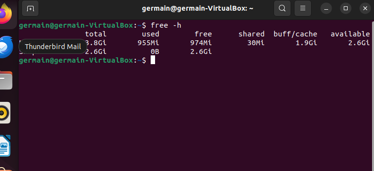
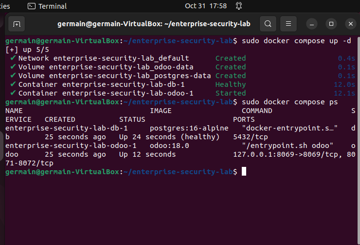
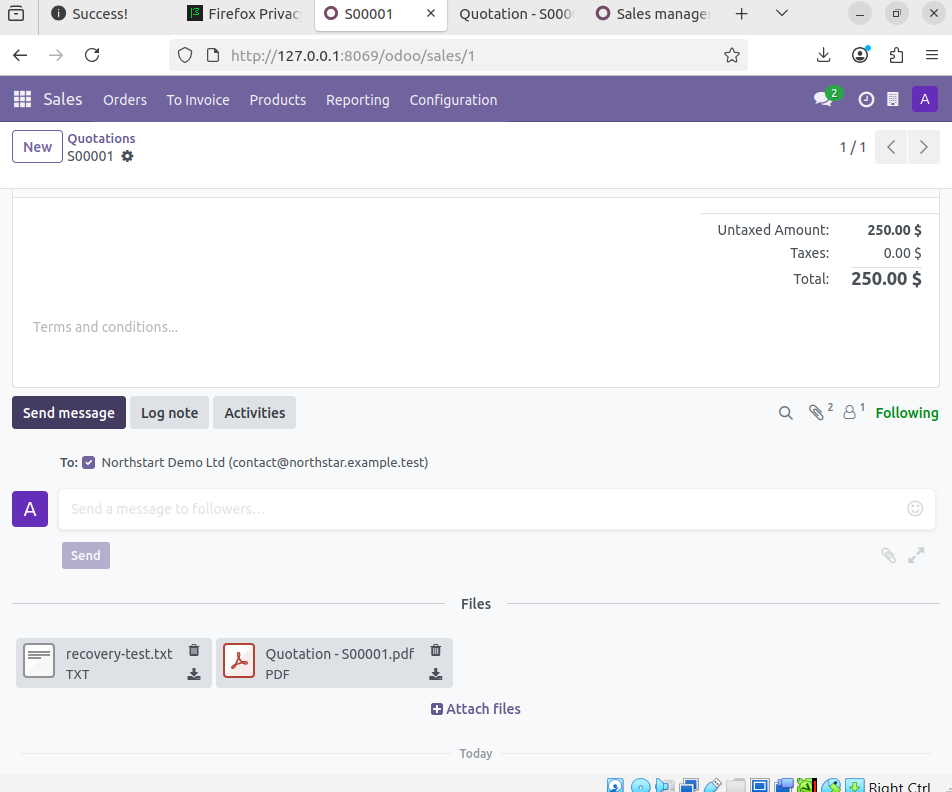

# Deployment and application baseline

[Project overview](../README.md) · [Screenshot gallery](gallery-01-platform.md) · [Application gallery](gallery-02-odoo.md)

## Ubuntu preparation

My Ubuntu VM initially had a full root filesystem and could not start the desktop normally. I checked `df -h /`, directory sizes, journal usage, disabled Snap revisions and large files in my home directory. Cleaning the journal recovered about 760 MB. After checking that an unused virtual disk was no longer needed, I removed it and brought free space to about 7.2 GB.

I increased the VM’s RAM from 2 GB to 4 GB. Once the desktop was working again, I used VirtualBox clipboard integration for the rest of the setup.



*E022: VM memory increased to 4 GB.*

## Docker and Compose

I installed Docker Engine and the Compose plugin from Docker's Ubuntu repository. The signing key lived at `/etc/apt/keyrings/docker.asc`. Installation included `docker-ce`, `docker-ce-cli`, `containerd.io`, `docker-buildx-plugin` and `docker-compose-plugin`. The `hello-world` container ran successfully. Docker administration used `sudo`.

I created the project in `/home/germain/enterprise-security-lab`, with separate `addons`, `config`, `scripts` and documentation directories. I generated a PostgreSQL password locally and kept it in an owner-readable `.env` file outside version control.

## Service design

| Service | Data | Exposure | Control |
|---|---|---|---|
| PostgreSQL | Named `postgres-data` volume | No host port | Health check with `pg_isready` |
| Odoo | Named `odoo-data` volume | Ubuntu loopback on 8069 | Waits for healthy database |
| Addons | Project directory | Read-only container mount | Separate from runtime data |

Both services used the `json-file` logging driver with three rotated files of 10 MB each. Named volumes retain data across container recreation but do not replace backups.

Configuration and startup checks:

```bash
sudo docker compose config -q
sudo docker compose config --services
sudo docker compose pull
sudo docker compose up -d
sudo docker compose ps
```

The captured startup result showed PostgreSQL healthy and Odoo running. The original application opened at `http://127.0.0.1:8069` inside Ubuntu.



*E032: Healthy PostgreSQL and running Odoo.*

## Business record baseline

The `enterprise_lab` database used English (US), Canada and no demo data. Sales activation also installed Invoicing dependencies.

| Record | Captured value |
|---|---|
| Customer | Northstart Demo Ltd |
| Test email | contact@northstar.example.test |
| Service product | IT Support Package |
| Quotation | S00001 |
| Quantity and unit price | 1 at $250 |
| Final quotation tax | 0% |
| Total and state | $250, Quotation / draft |
| Attachments | Quotation PDF and recovery-test.txt |

The customer spelling above matches the saved record. An earlier product screen showed a default 5% tax, while the final quotation used 0%. The recorded recovery baseline follows the final saved quotation.

The text attachment contained:

```text
Enterprise Security Lab
Recovery test attachment
Quotation: S00001
Customer: Northstart Demo Ltd
```



*E050: Text and PDF attachments in Odoo.*

## Configuration boundary

The reference Compose files in this repository reconstruct the lab layout. They do not include a database dump, the live `.env`, the effective `odoo.conf`, or a hardened production configuration. The manual restore later used the backed-up effective configuration as a read-only mount. Public deployment would require additional configuration for HTTPS, management access, secrets and network exposure.

## Official references

- [Docker Engine on Ubuntu](https://docs.docker.com/engine/install/ubuntu/)
- [Compose networking](https://docs.docker.com/compose/how-tos/networking/)
- [Odoo 18 deployment](https://www.odoo.com/documentation/18.0/administration/on_premise/deploy.html)
