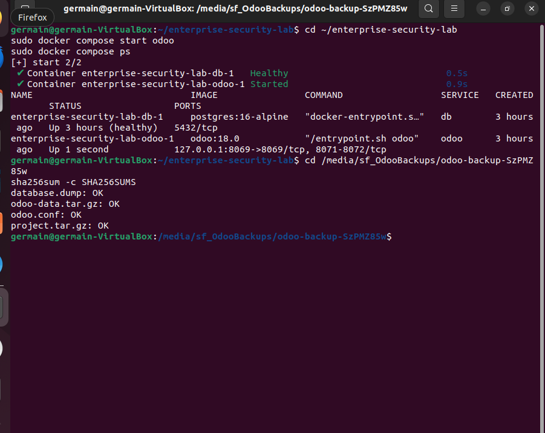
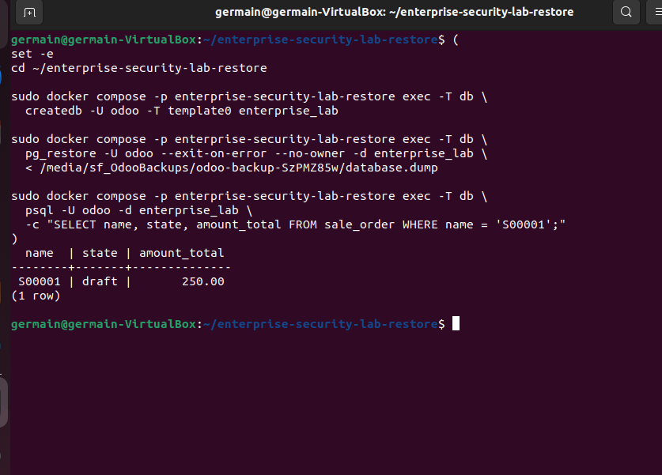
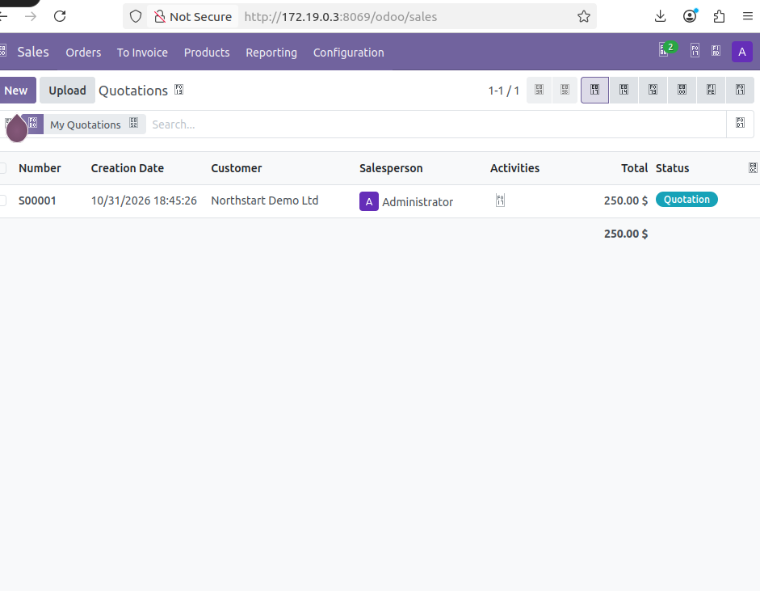

# Manual backup and isolated restore

[Project overview](../README.md) · [Recovery screenshot gallery](gallery-03-manual-recovery.md)

## Recovery objective

My goal was to recover the Odoo business record and its associated data into a separate instance while preserving my original deployment. The recovery unit includes the PostgreSQL database, Odoo filestore and required configuration.

## Backup destination

The Windows host directory `E:\Enterprise-Lab-Backups\Odoo` mapped to the permanent VirtualBox share `OdooBackups`, mounted in Ubuntu at `/media/sf_OdooBackups`. A write test confirmed that Ubuntu-created content appeared on Windows. Access depended on the guest shared-folder group permissions.

The observed bundle directory was `odoo-backup-SzPMZ85w`.

| File | Observed size | Role |
|---|---:|---|
| database.dump | 4.1 MB | PostgreSQL custom-format logical backup |
| odoo-data.tar.gz | 2.9 MB | Archived Odoo data including filestore |
| odoo.conf | 215 B | Effective Odoo configuration |
| project.tar.gz | 696 B | Compose, environment and project directories |
| database-contents.txt | 587 KB | Restore catalog listing |
| SHA256SUMS | 320 B | Integrity manifest for four primary files |

The complete bundle occupied approximately **7.5 MB**. Its archives include private configuration and credentials, so the actual bundle is intentionally absent from this public package.

## Coordinated backup procedure

I stopped the original Odoo service to prevent application writes and left PostgreSQL online. A custom-format `pg_dump` captured `enterprise_lab`, and `docker cp` streamed the stopped Odoo container's `/var/lib/odoo` directory into a compressed archive. The effective Odoo configuration and project files completed the recovery bundle.

I checked the PostgreSQL restore catalog, tested the compressed archives and verified the SHA-256 checksums. The first backup command changed working directory before its exit trap restarted Compose, causing a `no configuration file provided` error. I returned to the original project directory and restarted Odoo to correct the error. The source service then ran normally and all four checksum checks passed.

This procedure coordinates the database and filestore by pausing the application. It does not demonstrate a backup taken during live Odoo writes or a Veeam application-aware database integration.



*E062: Original service restarted and four checksums passed.*

## Separate recovery project

The restore directory was `/home/germain/enterprise-security-lab-restore`, restricted to its owner. The recovery Compose project used the explicit name `enterprise-security-lab-restore` so its database volume, application volume and network remained separate from the original stack.

Recovery controls:

- Separate named volumes and Compose project identity.
- Internal Docker network to limit outbound connectivity.
- Odoo scheduled workers disabled with `--max-cron-threads=0`.
- Backed-up Odoo configuration mounted read only.
- Original deployment preserved throughout validation.

I created the recovery database `enterprise_lab` from `template0` and imported the custom dump with `pg_restore --exit-on-error --no-owner`. I then queried `sale_order` and confirmed S00001 in draft state with a total of 250.00.

The Odoo filestore came from the `odoo/filestore` subtree of `odoo-data.tar.gz`. A one-off root container extracted it into the recovery volume and restored Odoo ownership. Runtime cache and session content were not required for the filestore restore.



*E065: Restored database query confirms S00001.*

## Restore validation

| Check | Observed outcome |
|---|---|
| PostgreSQL restore | Completed and returned the quotation through SQL |
| Recovery service startup | PostgreSQL healthy, Odoo running |
| Original source stack | Preserved and running |
| Recovery HTTP check | HTTP 200 at the recovery container address |
| Recovery browser check | Quotation list contains S00001 and Northstart Demo Ltd |
| Text baseline comparison | Matching original and downloaded text hashes |

The planned loopback port 8070 did not respond in this internal-network configuration. Inspection identified the recovery container address `172.19.0.3`, and Ubuntu reached Odoo directly at port 8069. That address is an observed value, not a fixed configuration contract.

The attachment text checksum recorded in the lab was:

```text
5c553359fe23a9641d32500a0bb4d430ef322e70b83e597e450589405876e40a
```

I confirmed that the restored instance was working through the SQL query and quotation UI. My attachment screenshots show the text baseline and matching hashes, but some show the original instance or omit the browser address. I need a clearer capture of an attachment downloaded directly from the isolated restore to complete that part of the record.



*E070: Restored Odoo quotation list at container IP.*

## Local staging for Veeam

I copied the bundle from the shared folder into `/home/germain/odoo-veeam-source`. The first copy failed because my guest session lacked shared-folder access. I completed the copy with elevated privileges, then assigned ownership on the local destination. The local staging directory remained private. All four manifest checks passed, and its size remained 7.5 MB.

This copy preserves the earlier manual recovery point. It is not a fresh export of the current Odoo database.

## Recovery measurements

I did not define target RTO/RPO values or time the recovery from start to finish. In my next exercise, I will record the backup timestamp, recovery start, service-ready time and completion of the business-data checks.

## Official reference

[PostgreSQL 16 pg_dump](https://www.postgresql.org/docs/16/app-pgdump.html) and [pg_restore](https://www.postgresql.org/docs/16/app-pgrestore.html)
