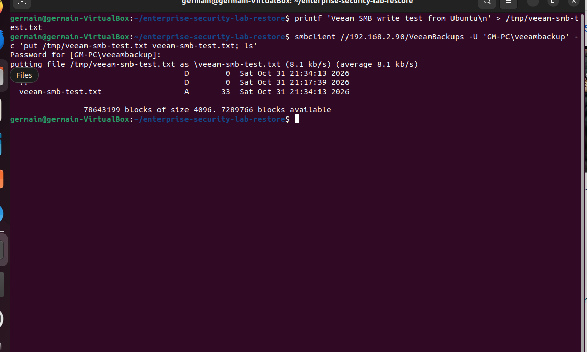
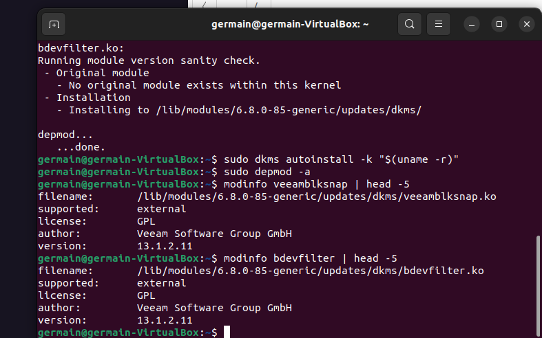
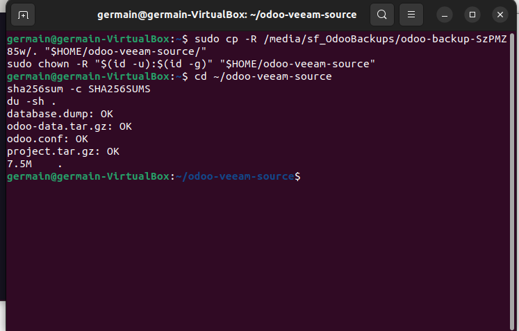

# Veeam Agent and Windows SMB integration

[Project overview](../README.md) · [SMB gallery](gallery-04-smb.md) · [Installation gallery](gallery-05-veeam-install.md) · [Job gallery](gallery-06-veeam-job.md)

## Windows SMB destination

| Setting | Observed configuration |
|---|---|
| Host computer | GM-PC |
| Host address | 192.168.2.90 |
| Windows directory | E:\Enterprise-Lab-Backups\Veeam |
| Share | VeeamBackups |
| Ubuntu UNC path | //192.168.2.90/VeeamBackups |
| Dedicated local account | GM-PC\veeambackup |
| Share access | Change |
| NTFS access | Modify, inherited by files and subdirectories |
| Network access | Scoped inbound TCP 445 rule on the active Public profile |

The firewall rule included the guest address and Windows host address to account for the observed VirtualBox network path. The network profile remained Public. Successful TCP and file-write tests validated access from Ubuntu.

The password stayed in a private prompt:

```bash
smbclient //192.168.2.90/VeeamBackups -U 'GM-PC\veeambackup'
```

The actual upload test wrote a 33-byte text file and listed it successfully. Veeam later reported `Repository_1` as SMB and accessible. Repository access alone does not prove that a backup has completed.



*E085: SMB upload test succeeds.*

## Agent installation

The `veeam-release-deb_13.0.2_amd64.deb` file configured the package repository. It was not the complete Agent installer. Updating APT exposed Veeam Agent version **13.1.2.11**, which the lab installed along with its `blksnap` dependency.

Kernel module work targeted `6.8.0-85-generic`. After the temporary-workspace cleanup incident described in the troubleshooting report, reinstalling the current kernel headers and rebuilding DKMS restored `veeamblksnap.ko` and `bdevfilter.ko`. `modinfo` showed both under `/lib/modules/6.8.0-85-generic/updates/dkms/` with version 13.1.2.11.



*E102: Veeam modules rebuilt successfully.*

## Recovery media attempt

An initial download selected a 32-bit i386 recovery ISO, which did not match the guest's amd64 architecture. Veeam's later Download and patch ISO workflow failed with `No space left on device`. Recovery-media generation did not complete, and this lab does not claim a tested bootable recovery ISO.

## Full-machine backup attempt

The saved job `BackupJob1` remained `All System`. It targeted `Repository_1` and started at the guest's recorded time 22:51:37. It created a snapshot and processed about 1.9 GB before the visible progress remained at 8%. The screen showed 373.3 MB transferred and `Target` as the bottleneck.

At the same time, guest root usage reached 99% with 453 MB free. Veeam logged low snapshot free space and a request to extend `/.veeamsnapstorage`. The Windows shared-folder capacity report showed available host storage, but did not establish an independent measurement of the exact Veeam target at that moment.

Normal stop left the session in `Stopping`. A forced stop ended it with `Failed` and recovered root space to approximately 2.7 GB. This attempt did not establish a usable successful restore point.

## Smaller file-backup workflow

The prepared source is `/home/germain/odoo-veeam-source`, containing the existing verified 7.5 MB manual recovery bundle. The instructed Veeam configuration uses:

| Option | Intended value |
|---|---|
| Backup mode | File level backup |
| Disable snapshot | Selected |
| Protected source | Only /home/germain/odoo-veeam-source |
| Destination | Existing Windows SMB share |
| Scheduling | Manual for the exercise |
| Recovery destination | A separate folder, preserving the source bundle |

A snapshot-less backup suits this static exported bundle. It does not turn copies of live PostgreSQL data files into an application-consistent database backup. The manual export establishes the database and filestore recovery unit first.



*E117: Local recovery bundle four checksums pass.*

## Verification boundary

The last supplied screenshot shows the old full-machine session as `Failed`. The user subsequently reported that the instructed work was done. The publication package records that update without inventing a successful Veeam session or restore result.

Evidence needed to close the Veeam exercise:

1. A saved job summary showing file-level scope, the source directory and snapshot disabled.
2. A backup session with final state `Success` and a usable restore point.
3. Recovery of the bundle through Veeam into a separate directory.
4. Four successful `sha256sum -c SHA256SUMS` checks in the recovered copy.

The existing manual Odoo restoration remains a completed and separately documented result.

## Official references

- [Select backup mode](https://helpcenter.veeam.com/docs/agentforlinux/userguide/backup_job_mode.html)
- [Snapshot-less file-level backup](https://helpcenter.veeam.com/docs/agentforlinux/userguide/file_backup_snapshotless.html)
- [Veeam Agent for Linux guide](https://helpcenter.veeam.com/docs/agentforlinux/userguide/overview.html)
