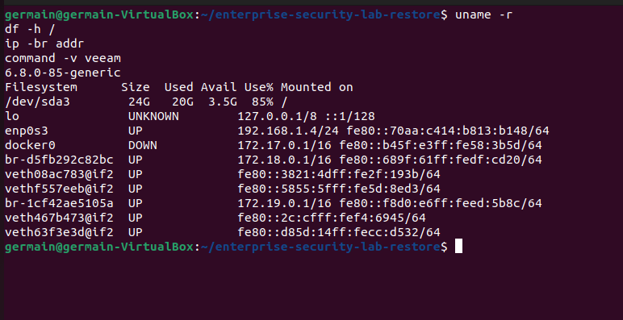
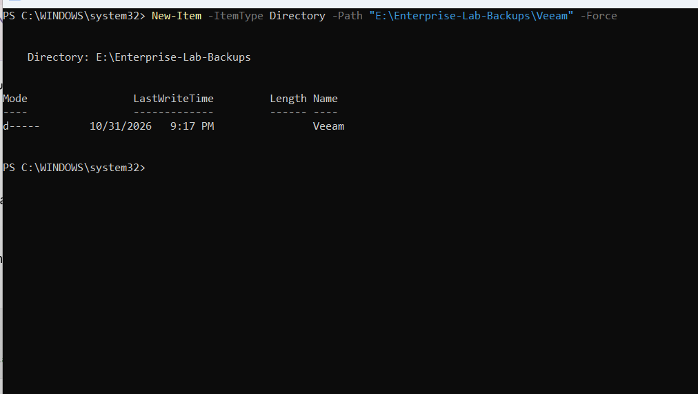
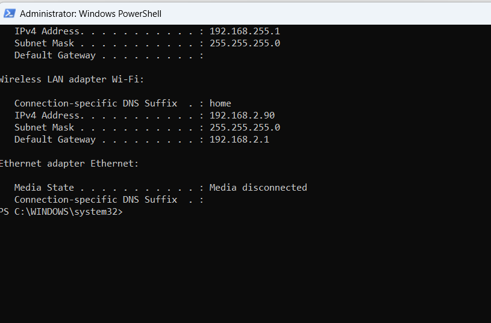
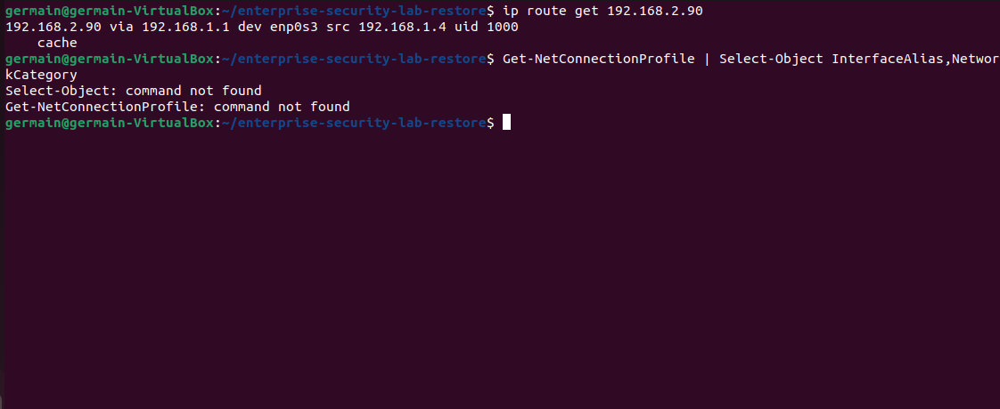
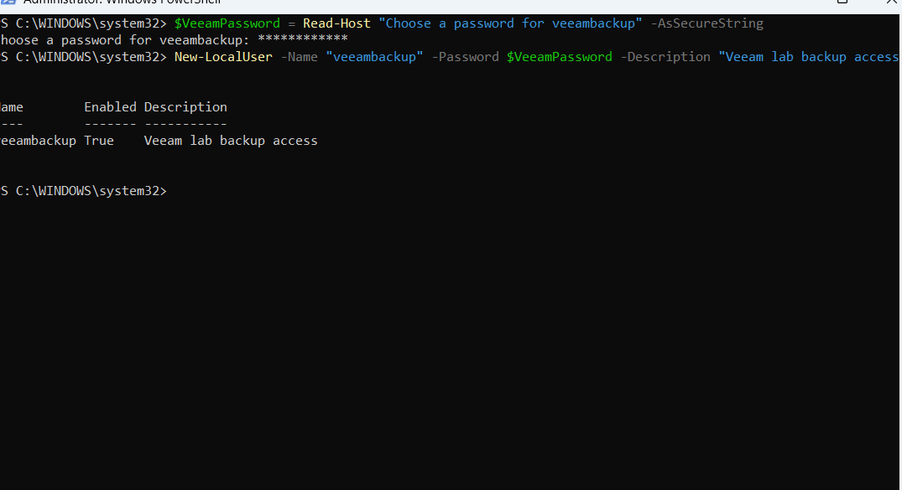
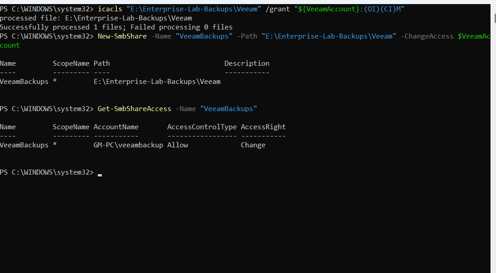
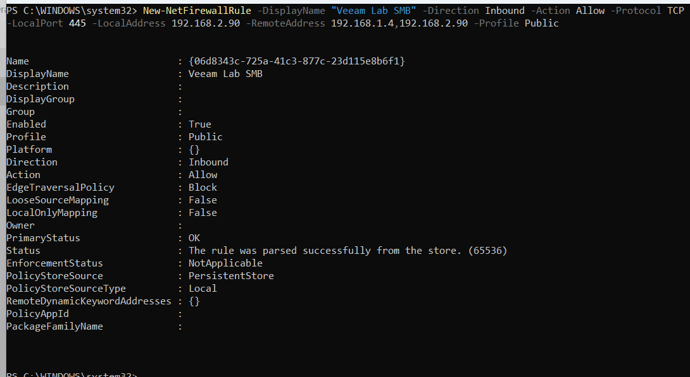
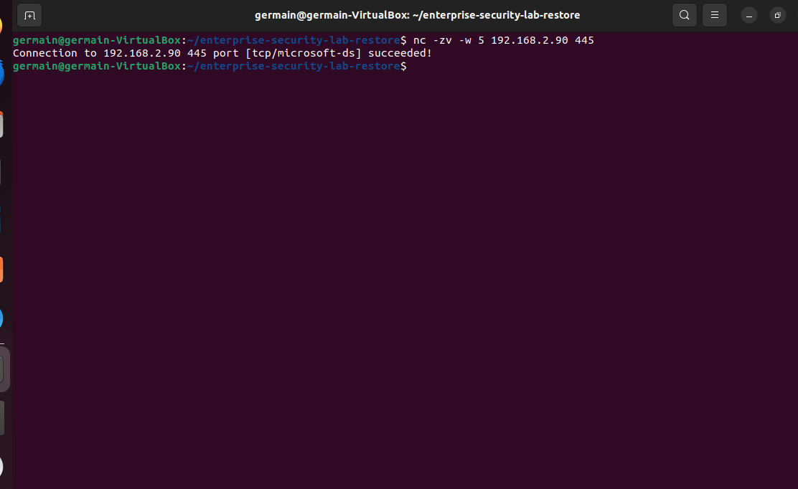
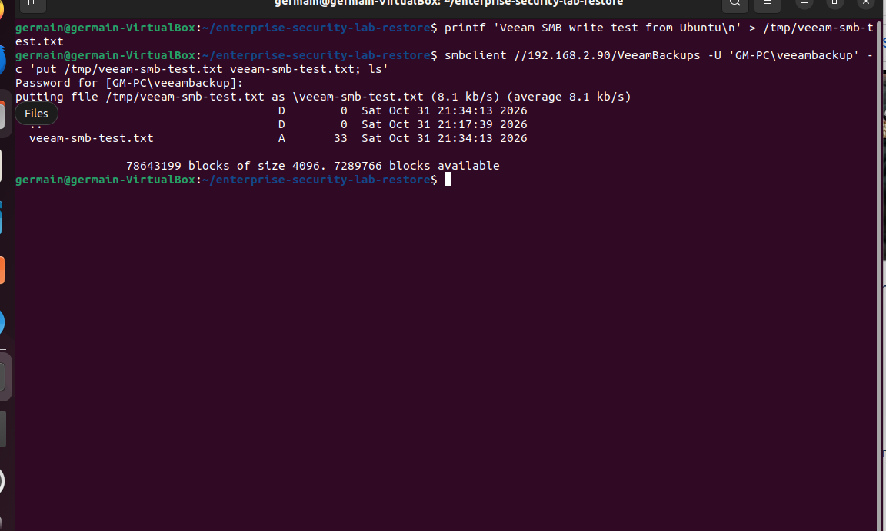

# Windows SMB destination

[Back to evidence index](EVIDENCE.md)

## E077 · Veeam preflight and system details

Capture: `20261101-011608`.

## E078 · Windows Veeam backup directory

Capture: `20261101-011757`.

## E079 · Windows network addresses

Capture: `20261101-011905`.

## E080 · Ubuntu route and shell troubleshooting

Capture: `20261101-012045`.

## E081 · Dedicated Windows backup account

Capture: `20261101-012550`.

## E082 · SMB share permissions

Capture: `20261101-012819`.

## E083 · Scoped SMB firewall rule

Capture: `20261101-013014`.

## E084 · SMB TCP 445 connection succeeds

Capture: `20261101-013148`.

## E085 · SMB upload test succeeds

Capture: `20261101-013449`.

