# Veeam installation and recovery media troubleshooting

[Back to evidence index](EVIDENCE.md)

## E086 · Download page navigation

Capture: `20261101-014152`.

## E087 · Recovery media architecture choices

Capture: `20261101-014542`.

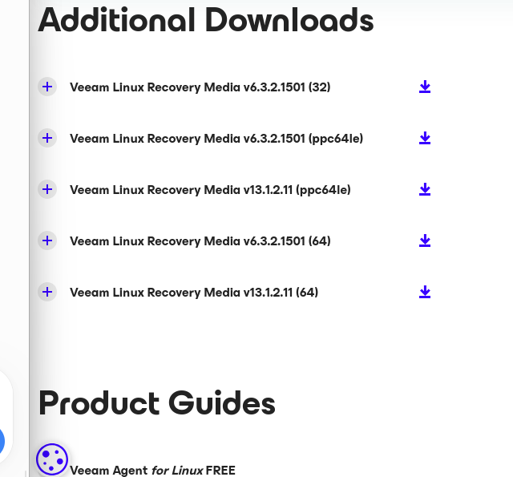

## E088 · Repository package and 32-bit ISO download

Capture: `20261101-014717`.

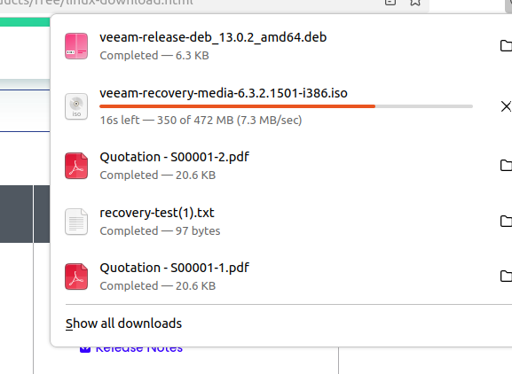

## E089 · Veeam repository and candidate version

Capture: `20261101-014940`.

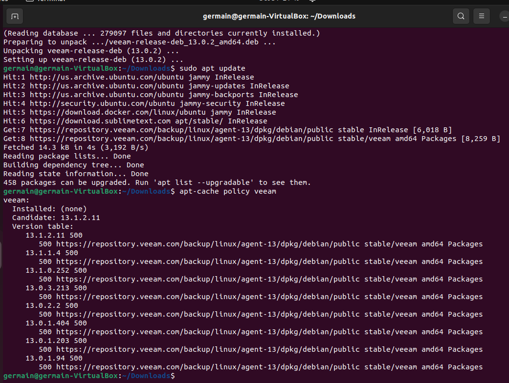

## E090 · Veeam Agent installation completes

Capture: `20261101-015345`.

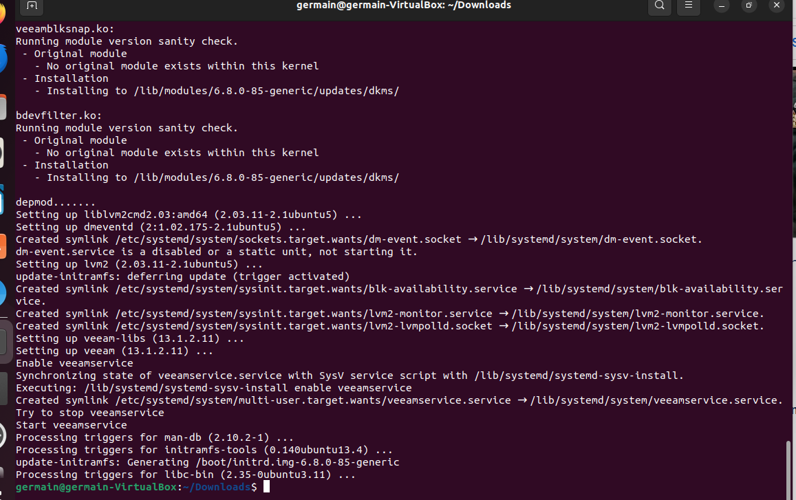

## E091 · License agreement screen

Capture: `20261101-015518`.

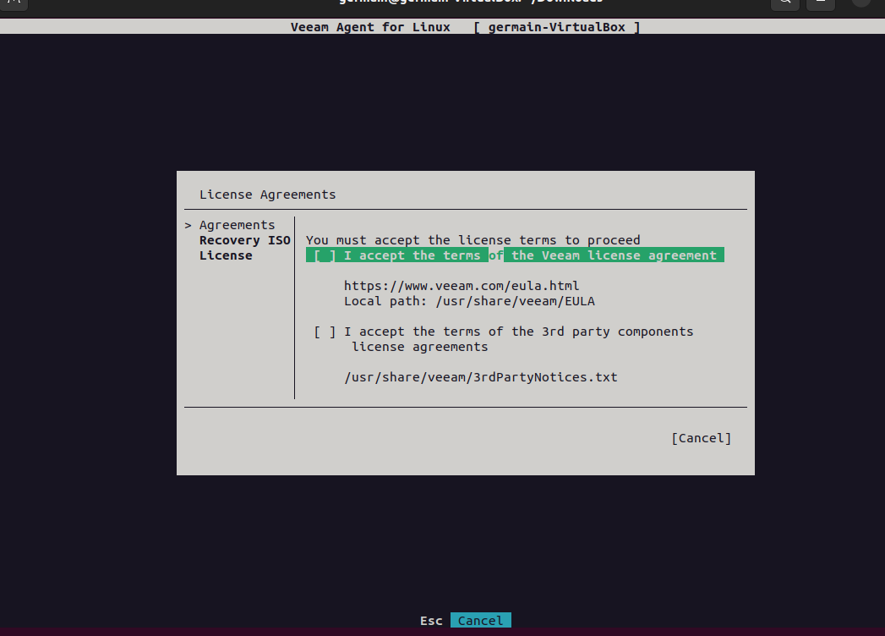

## E092 · License acceptance selection

Capture: `20261101-015937`.

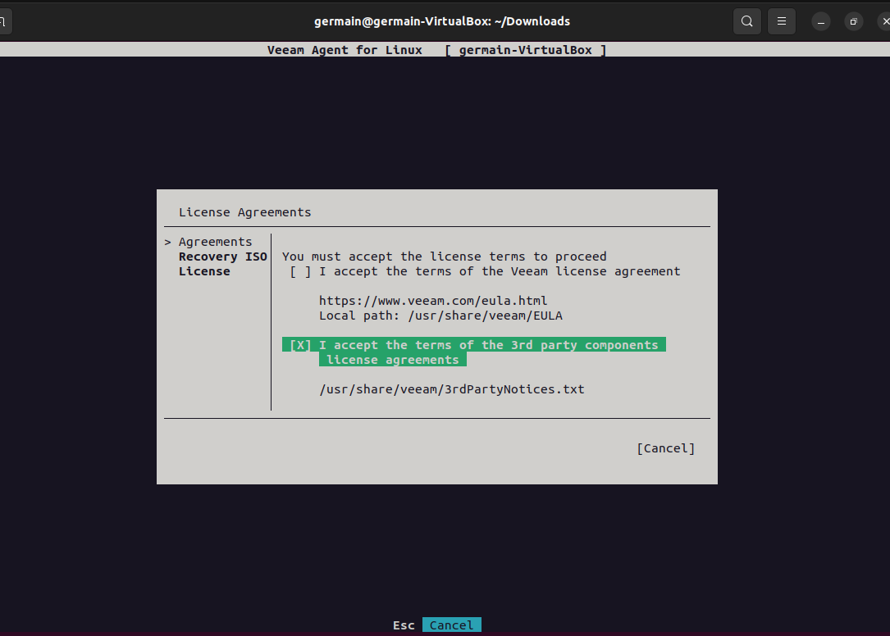

## E093 · Both agreements selected

Capture: `20261101-020045`.

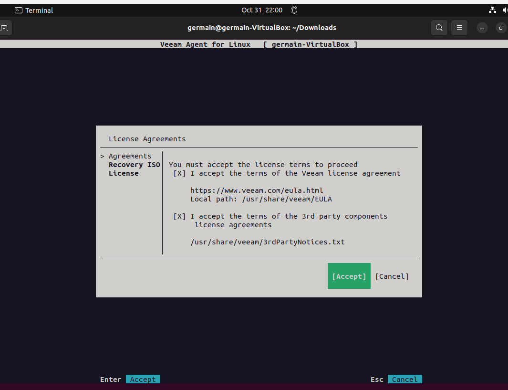

## E094 · Recovery ISO creation fails for lack of space

Capture: `20261101-021207`.

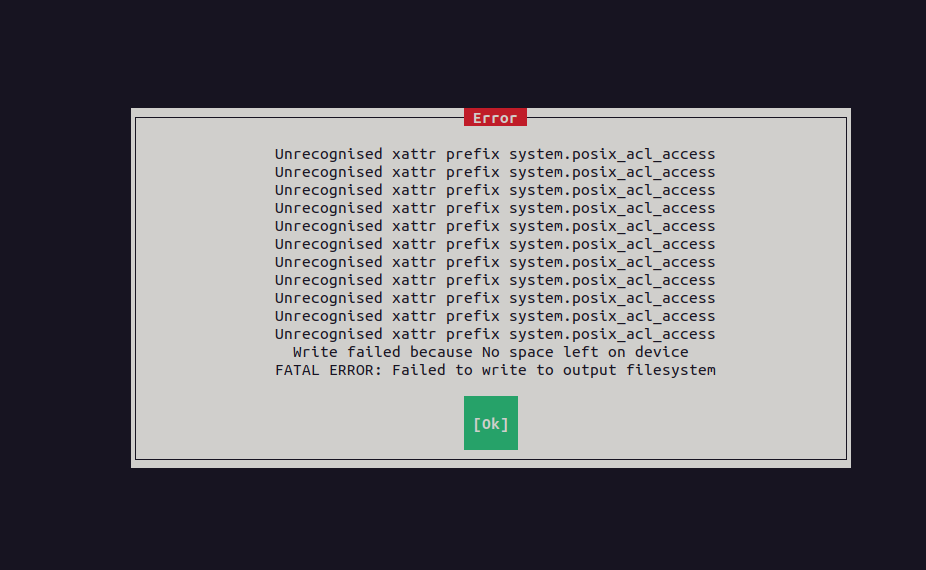

## E095 · Root free space after ISO failure

Capture: `20261101-021435`.

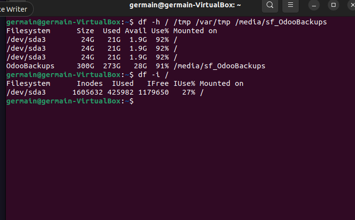

## E096 · Veeam temporary workspace usage

Capture: `20261101-021644`.

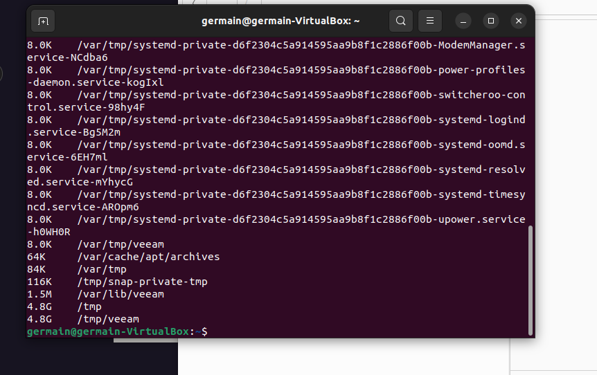

## E097 · Disk usage analyzer

Capture: `20261101-021755`.

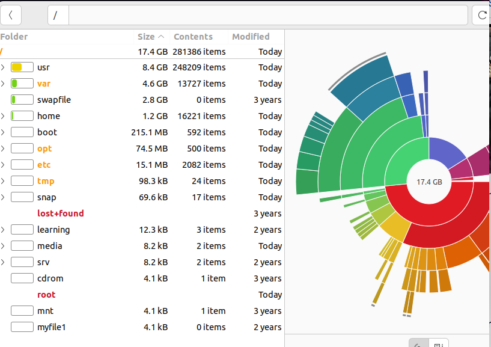

## E098 · Unsafe temporary cleanup encounters active bind mounts

Capture: `20261101-021846`.

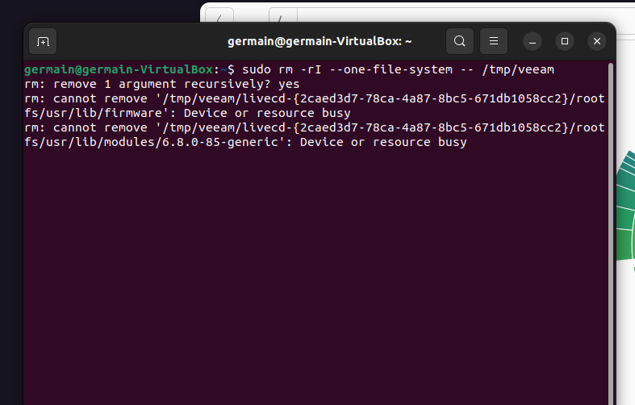

## E099 · Bind mounts identify host firmware and module paths

Capture: `20261101-022002`.

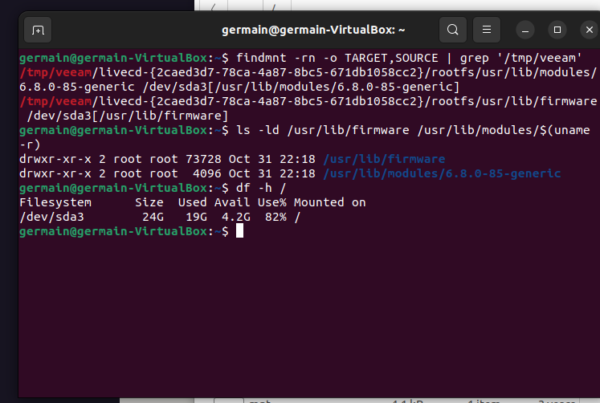

## E100 · Veeam modules missing during repair

Capture: `20261101-022729`.

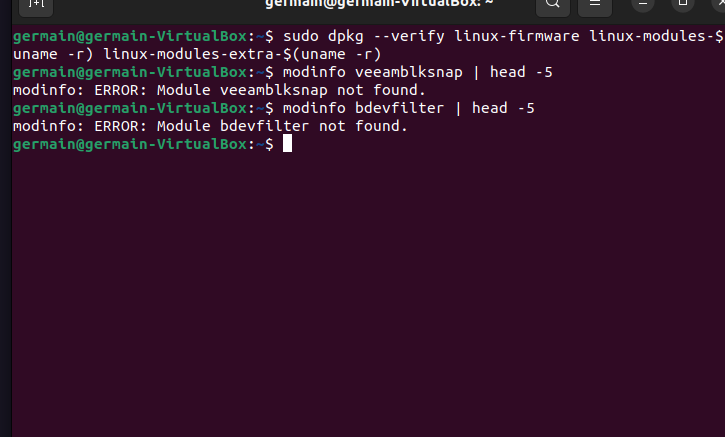

## E101 · DKMS rebuild requires current kernel headers

Capture: `20261101-022916`.

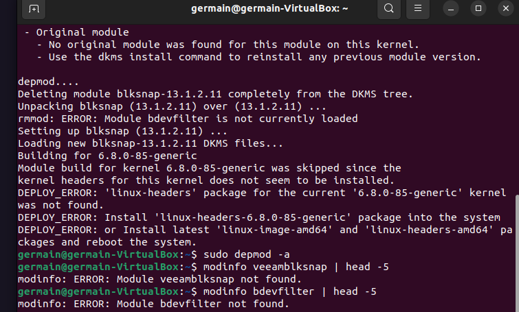

## E102 · Veeam modules rebuilt successfully

Capture: `20261101-023147`.

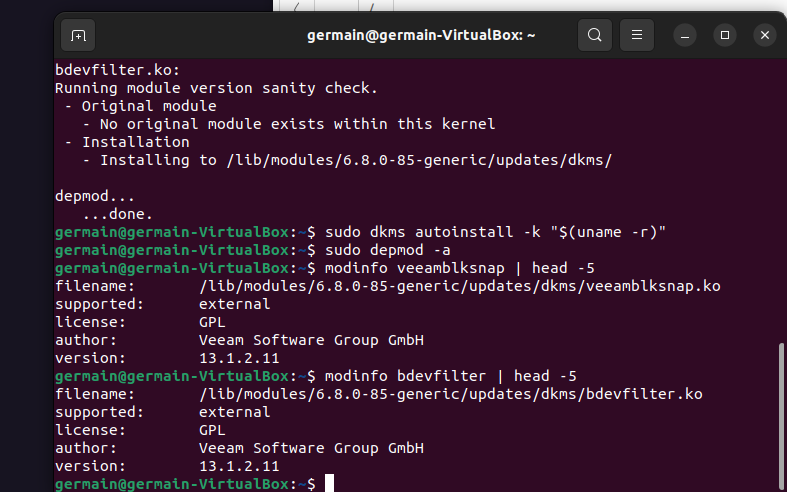

## E103 · Veeam Agent main interface

Capture: `20261101-023536`.

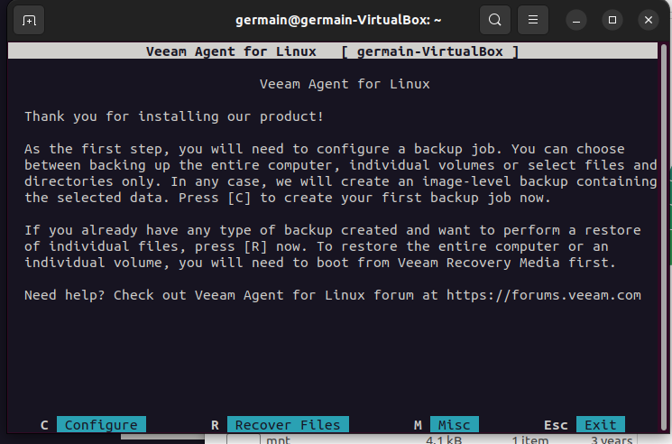
