# Veeam job attempt and verified recovery source

[Back to evidence index](EVIDENCE.md)

## E104 · Backup job naming screen

Capture: `20261101-023701`.

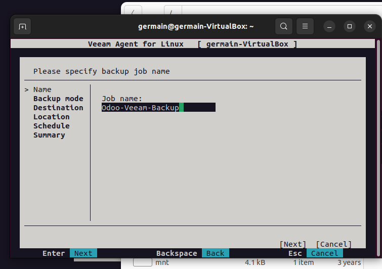

## E105 · Entire-machine mode remains selected

Capture: `20261101-023744`.

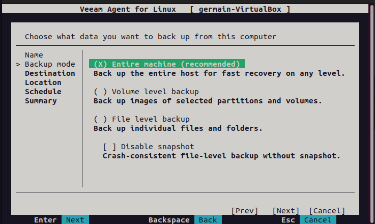

## E106 · Entire-machine mode confirmation

Capture: `20261101-023937`.

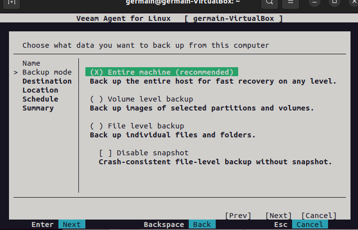

## E107 · Backup destination selection screen

Capture: `20261101-024029`.

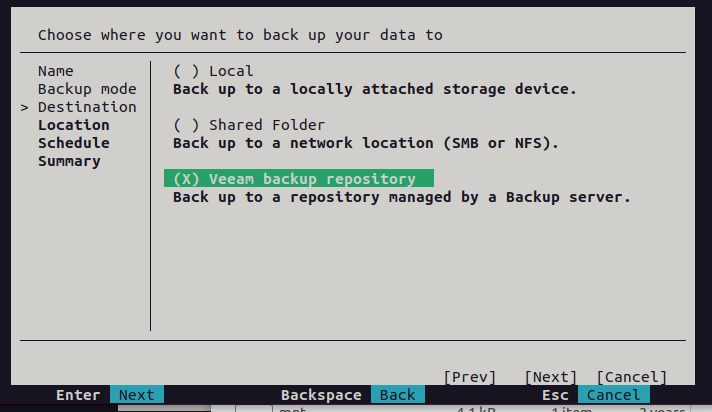

## E108 · Network protocol selection screen

Capture: `20261101-024154`.

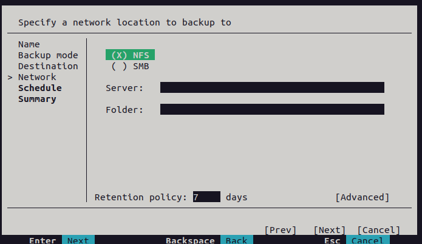

## E109 · Automatic schedule screen

Capture: `20261101-025050`.

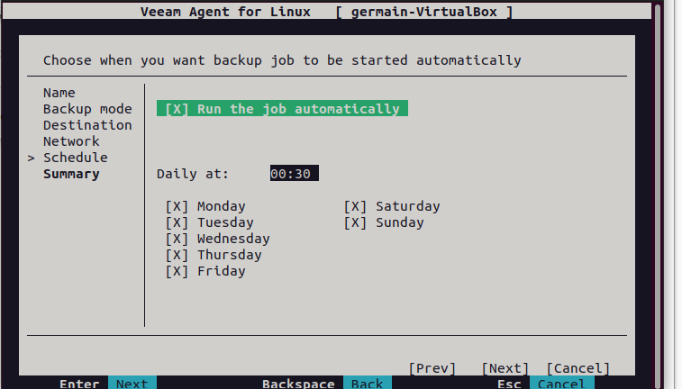

## E110 · Full-machine job starts

Capture: `20261101-025213`.

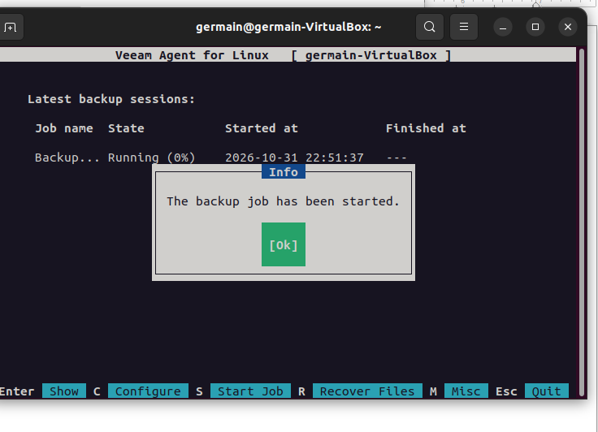

## E111 · Backup running at 8 percent

Capture: `20261101-025342`.

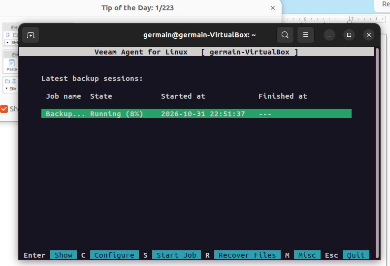

## E112 · Snapshot backup transfer statistics

Capture: `20261101-025539`.

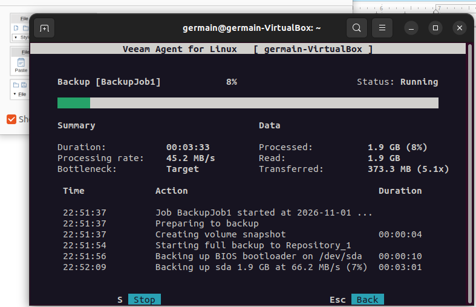

## E113 · Backup remains at 8 percent

Capture: `20261101-030344`.

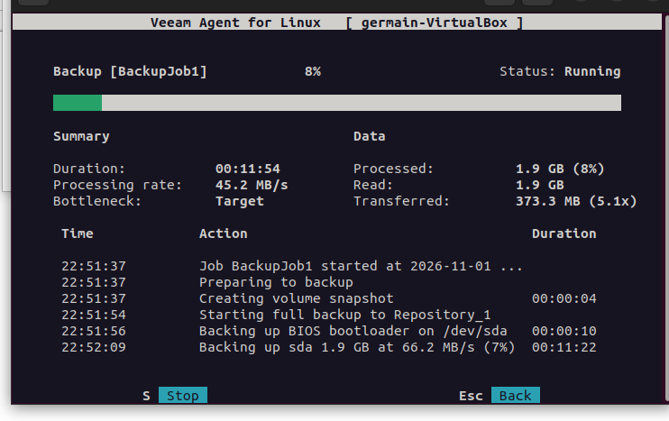

## E114 · Root filesystem reaches 99 percent usage

Capture: `20261101-030623`.

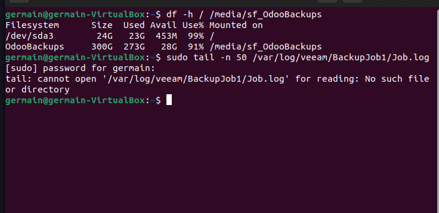

## E115 · Storage and Veeam log discovery

Capture: `20261101-030824`.

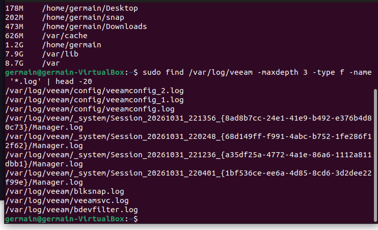

## E116 · All System job and accessible SMB repository

Capture: `20261101-031636`.

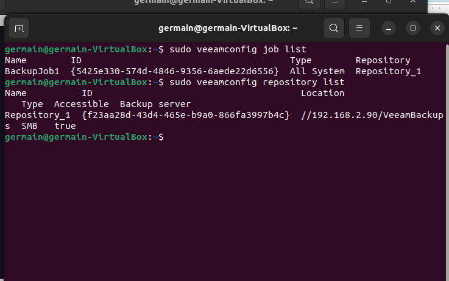

## E117 · Local recovery bundle four checksums pass

Capture: `20261101-032032`.

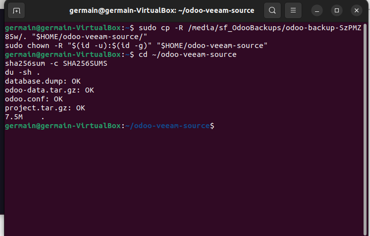

## E118 · Stopped full-machine session shows Failed

Capture: `20261101-032145`.

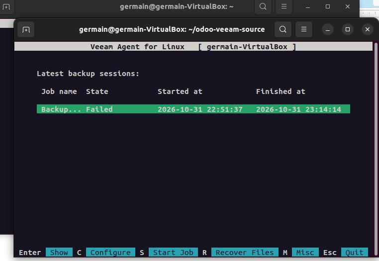
